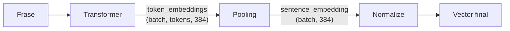

# Sentence Transformers

## El mòdul de Pooling: de tokens a frases

<div class="absolute bottom-10 left-14 text-sm opacity-80">
  Toni López Llao
</div>

<!--
Presentació: avui veurem una peça petita però imprescindible de Sentence Transformers, el mòdul Pooling.
-->

---

# Índex

<v-clicks>

1. **Context:** Transformers i Sentence Transformers
2. **El problema:** molts vectors de tokens, un sol vector de frase
3. **Estratègies de pooling:** mean, CLS, max i altres
4. **Implementació:** la classe `Pooling` pas a pas
5. **Integració:** com encaixa dins del model i com es desa
6. **Aplicació:** semantic search
7. **Conclusions**

</v-clicks>

---
layout: section
---

# 1. Context

Transformers i Sentence Transformers

---

# Transformers

<TransformersDiagram/>

<!--
Un Transformer processa la frase i retorna un vector per a cada token, enriquit amb el context de la resta de la frase.
-->

---
layout: center
---
# Què és Sentence Transformers?

<div class="text-2xl">

| Frase (consulta: "Gat negre") | Keyword | Semantic |
| --- | :---: | :---: |
| "El gat negre és maco" | ✓ | ✓ |
| "El felí fosc miola" | ✗ | ✓ |
| "Els cotxes negres" | ✓ | ✗ |

</div>

---
layout: section
---

# 2. Pregunta de partida


---

# La pregunta de partida

## Com passem de vectors de **tokens** a un vector de **frase**?

<PoolingDiagram/>

<div class="mt-4 opacity-80">Per comparar dues frases necessitem exactament <b>un vector per frase</b>.</div>

---
layout: two-cols
---

# Què és el pooling?

```text
Frase: "Gat negre"
          ↓
  BERT tokenitza i processa
          ↓
Token 1: [0.1, 0.2, 0.3]
Token 2: [0.5, 0.6, 0.7]
```

<div class="mt-4">

Tenim **2 vectors**, però en necessitem **1**.

</div>

::right::

<div class="h-full flex flex-col justify-center pl-8">

**En forma de tensors**

| | Forma |
| --- | --- |
| Entrada | `(batch, tokens, dim)` |
| Sortida | `(batch, dim)` |

<div class="mt-4 text-sm opacity-70">El pooling elimina la dimensió dels tokens.</div>

</div>

---
layout: section
---

# 3. Estratègies de pooling

---
layout: two-cols
---

# Mean pooling

**Com funciona:** fa la mitjana de tots els tokens, component a component.

**Característiques**

- Representació global de tota la frase
- Totes les paraules compten igual
- Opció per defecte de Sentence Transformers

<div class="mt-4 text-sm opacity-70">Ideal per a semantic search i similitud entre frases.</div>

::right::

<div class="h-full flex items-center justify-center">
  <PoolingStrategy mode="mean" />
</div>

---
layout: two-cols
---

# CLS pooling

**Com funciona:** es queda només amb el vector del token especial `[CLS]`, el primer, i ignora la resta.

**Característiques**

- Pensat per a models entrenats perquè `[CLS]` resumeixi la frase
- Molt ràpid: no cal cap operació
- Si el model no s'ha entrenat així, el resultat empitjora

::right::

<div class="h-full flex items-center justify-center">
  <PoolingStrategy mode="cls" />
</div>

---
layout: two-cols
---

# Max pooling

**Com funciona:** per a cada posició del vector, es queda amb el valor més alt entre tots els tokens.

**Característiques**

- Captura les característiques més destacades
- Útil quan una paraula clau marca el significat
- Menys sensible a les paraules de farciment

::right::

<div class="h-full flex items-center justify-center">
  <PoolingStrategy mode="max" />
</div>

---

# Tots els modes disponibles

| Mode | Què fa | Típic en |
| --- | --- | --- |
| `cls` | Primer token real | Models tipus BERT |
| `max` | Màxim per columna | Casos amb paraules clau |
| `mean` | Mitjana dels tokens reals | La majoria de models |
| `mean_sqrt_len_tokens` | Suma ÷ √(nombre de tokens) | Variants de mean |
| `weightedmean` | Mitjana on els tokens posteriors pesen més | Models decoder (SGPT) |
| `lasttoken` | Últim token real | Models decoder (tipus GPT) |

<div class="mt-4">

Es poden **combinar**: els vectors es concatenen.

```python
Pooling(384, pooling_mode=("mean", "max"))   # sortida: 384 × 2 = 768
```

</div>

<!--
weightedmean i lasttoken existeixen pels models decoder: amb atenció causal, els tokens del final són els que han vist tota la frase.
-->

---
layout: section
---

# 4. Implementació

La classe `Pooling` pas a pas

---

# La classe `Pooling`

```python {all|2|4-8|10-13}{maxHeight:'400px'}
class Pooling(nn.Module):
    POOLING_MODES = ("cls", "max", "mean", "mean_sqrt_len_tokens", "weightedmean", "lasttoken")

    def __init__(self, embedding_dimension: int,
                 pooling_mode: str | tuple[str, ...] = "mean",
                 include_prompt: bool = True):
        super().__init__()
        modes = (pooling_mode,) if isinstance(pooling_mode, str) else tuple(pooling_mode)

        for mode in modes:
            if mode not in self.POOLING_MODES:
                raise ValueError(f"Mode desconegut: {mode}")
        self.pooling_mode = modes

        self.embedding_dimension = embedding_dimension
        self.include_prompt = include_prompt
        self.pooling_output_dimension = len(modes) * embedding_dimension
```

<div class="text-sm opacity-70">Versió simplificada. A la llibreria, uns decoradors converteixen els arguments antics (<code>pooling_mode_mean_tokens=True</code>…) al nou <code>pooling_mode</code> i mostren un <code>FutureWarning</code>.</div>

---

# El mètode `forward`

Rep un **diccionari** `features` que circula entre mòduls i hi afegeix `sentence_embedding`.

```python {maxHeight:'360px'}
def forward(self, features: dict) -> dict:
    token_embeddings = features["token_embeddings"]  # (batch, tokens, dim)

    if "cu_seq_lens_q" in features:
        # Seqüències empaquetades en un sol tensor (flash-attention)
        output_vectors = self._forward_flattened(token_embeddings, features)
    else:
        # Cas normal: batch amb padding + attention_mask
        attention_mask = features["attention_mask"]  # (batch, tokens)
        if not self.include_prompt and "prompt_length" in features:
            attention_mask = self._exclude_prompt_from_mask(
                attention_mask, features["prompt_length"]
            )
        output_vectors = self._forward_padded(token_embeddings, attention_mask)

    features["sentence_embedding"] = torch.cat(output_vectors, dim=-1)
    return features
```

<!--
Dues branques: la normal, amb padding, i l'optimitzada, amb seqüències empaquetades. include_prompt=False serveix per a models amb instruccions (INSTRUCTOR): el prompt no ha d'influir al vector.
-->

---
layout: two-cols
---

# Per què cal la màscara?

En un batch, les frases curtes s'omplen amb `[PAD]`:

```text
"Gat negre"     → [CLS] gat negre [SEP] [PAD] [PAD]
attention_mask  →   1    1    1    1     0     0
```

Una mitjana simple (`.mean(dim=1)`) inclouria els `[PAD]` i **falsejaria el resultat**.

La `attention_mask` indica quins tokens són reals (`1`) i quins són farciment (`0`).

::right::

<div class="pl-8">

**Mean amb màscara**

```python {all|1|2|3|4}
mask = attention_mask.unsqueeze(-1).float()
suma = (token_embeddings * mask).sum(dim=1)
n_tokens = mask.sum(dim=1).clamp(min=1e-9)
mean = suma / n_tokens          # (batch, dim)
```

**Max amb màscara**

```python
token_embeddings[mask.squeeze(-1) == 0] = float("-inf")
max_vec = token_embeddings.max(dim=1).values
```

<div class="mt-2 text-sm opacity-70">Amb -inf, un [PAD] mai pot guanyar el màxim.</div>

</div>

---
layout: section
---

# 5. Integració

Com encaixa dins del model i com es desa

---

# Com encaixa al model

`SentenceTransformer` és una cadena de mòduls (`nn.Sequential`).



<v-clicks>

- **Transformer:** un vector per token
- **Pooling:** un vector per frase
- **Normalize:** vector de llargada 1, així la similitud cosinus és un producte escalar

</v-clicks>

---
layout: two-cols
---

# Muntar el model a mà

```python {all|1|2|3|5}
transformer = Transformer(
    "sentence-transformers/all-MiniLM-L6-v2",
    max_seq_length=256,
)
pooling = Pooling(
    transformer.get_embedding_dimension(),
    pooling_mode="mean",
)
normalize = Normalize()

model = SentenceTransformer(
    modules=[transformer, pooling, normalize]
)
```

::right::

<div class="h-full flex flex-col justify-center pl-8">

`get_embedding_dimension()` **connecta** els mòduls: el Pooling sap la mida dels vectors que rep, i retorna la mida dels que produeix.

</div>

---
layout: two-cols
---

# Desar i carregar

`Pooling` **no té pesos entrenables**: només desa la configuració.

```python
def get_embedding_dimension(self) -> int:
    return self.pooling_output_dimension

def save(self, output_path: str):
    path = os.path.join(output_path, "config.json")
    with open(path, "w") as f:
        json.dump(self.get_config_dict(), f, indent=2)
```

**`1_Pooling/config.json`**

```json
{ "embedding_dimension": 384,
  "pooling_mode": "mean",
  "include_prompt": true }
```

::right::

<div class="pl-8">

**Estructura del model desat**

```text
all-MiniLM-L6-v2/
├── modules.json        ← ordre dels mòduls
├── config.json         ← Transformer
├── model.safetensors   ← pesos
├── 1_Pooling/
│   └── config.json     ← Pooling
└── 2_Normalize/
```

<div class="mt-2 text-sm opacity-70">En carregar, cada carpeta reconstrueix el seu mòdul. Els config antics, amb booleans, encara es poden carregar gràcies als decoradors de compatibilitat.</div>

</div>

---
layout: section
---

# 6. Aplicació

Semantic search

---
layout: two-cols
---

# Semantic search

```python {all|1|3-7|9}
model = SentenceTransformer("sentence-transformers/all-MiniLM-L6-v2")

query = model.encode("Gats negres")
docs = model.encode([
    "El gat negre és maco",
    "Els cotxes negres",
])

scores = model.similarity(query, docs)
```

::right::

<div class="h-full flex flex-col justify-center pl-8">

| Frase | Resultat |
| --- | :---: |
| "El gat negre és maco" | ✓ Més similar |
| "Els cotxes negres" | ✗ Menys similar |

<div class="mt-4">

Gràcies al pooling, cada frase és **un sol vector** i comparar-les és tan simple com calcular una similitud.

</div>

</div>

---
layout: section
---

# 7. Conclusions

---

# Conclusions

<v-clicks>

- **Simple però imprescindible:** sense pooling no hi ha un vector per frase
- **La base de la semantic search** i la similitud entre frases
- **Diverses estratègies** (mean, CLS, max…) segons com s'ha entrenat el model
- **Robust en la pràctica:** màscara de padding, prompts i seqüències empaquetades
- **Codi obert:** git, pull requests i tests
- **Connexió amb la carrera:** àlgebra lineal, xarxes neuronals i enginyeria de software

</v-clicks>

---
layout: center
class: text-center
---

# Gràcies!

## Preguntes?

---

# Recursos

<div class="grid grid-cols-2 gap-8">

<div>

**Codi**

- GitHub: `sentence-transformers`
- Mòdul: `Pooling` (`pooling.py`)
- Tests: `test_pooling.py`

</div>

<div>

**Documentació**

- sbert.net (documentació oficial)
- deepwiki.com
- pytorch.org

</div>

</div>